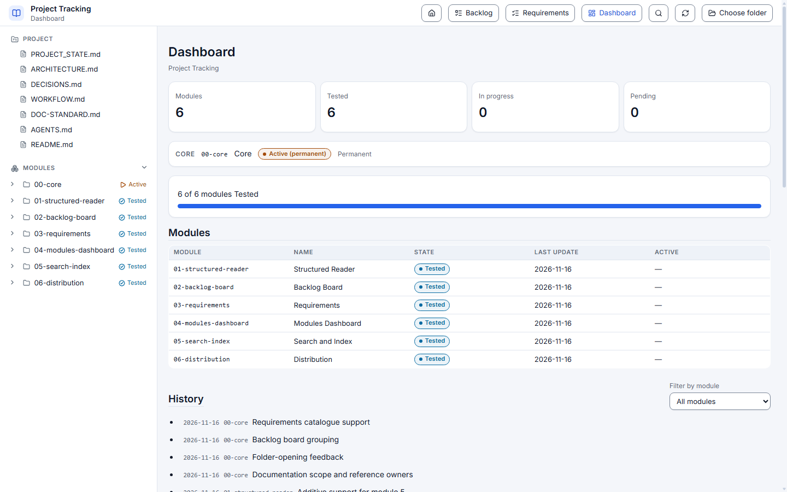

# Project Tracking

> A portable, install-free and offline reader for a project's Markdown documentation.

Project Tracking turns the Markdown documentation of a project into a navigable,
interactive reading experience: chapters, tables, statuses and cross-references.
It is one self-contained HTML file, works offline and never writes to the
documents it reads.

## What you can do

- **Read** chapters and sections with a stable sidebar and anchored headings.
- **Work with tables**: recognise statuses, filter, sort and open a full row in a
  modal.
- **Follow references** between documents and from any known identifier to the
  item that defines it.
- **See the project at a glance** through the modules dashboard, backlog board,
  requirements catalogue and a filterable changelog timeline.
- **Search everything** with `Ctrl+K` or the banner magnifier, with excerpts and
  jumps to the source section.
- **Read offline**; icons and the typeface are optional and fall back to glyphs
  and the system font.

## Start

Open `dist/index.html` in Chrome or Edge and choose the project folder. No server,
installation or build step is needed to read a project.

## Documentation

- [PROJECT_STATE.md](PROJECT_STATE.md) — project index, modules and next steps.
- [docs/WORKFLOW.md](docs/WORKFLOW.md) — module cycle, states and definition of done.
- [docs/ARCHITECTURE.md](docs/ARCHITECTURE.md) — code organisation and operations.
- [docs/DECISIONS.md](docs/DECISIONS.md) — approved decisions and open questions.
- [AGENTS.md](AGENTS.md) — onboarding rules for AI agents.

Architecture, operations and commands live in
[`docs/ARCHITECTURE.md` §9](docs/ARCHITECTURE.md#9-environments-and-operations) and
[`PROJECT_STATE.md` §2](PROJECT_STATE.md#2-stack-and-environment).

> The reader is English-only, light-only and read-only.
